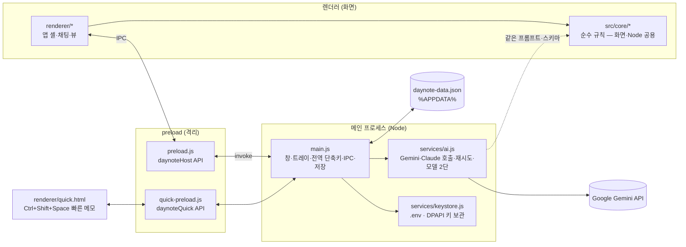
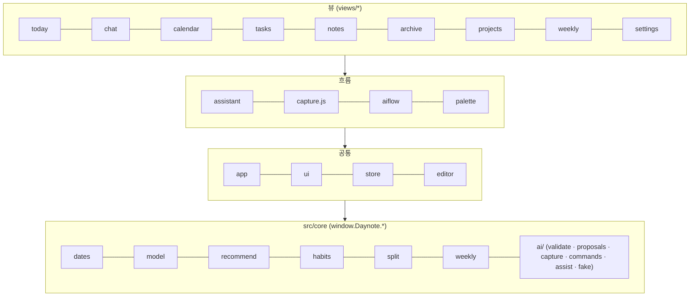
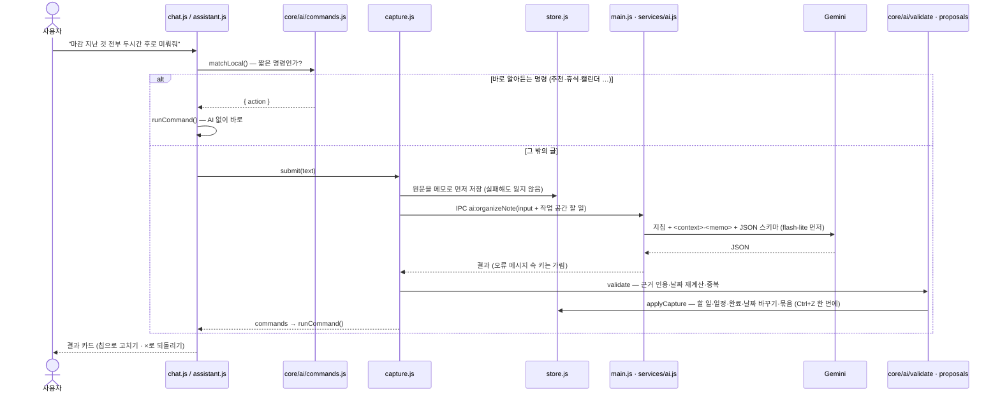
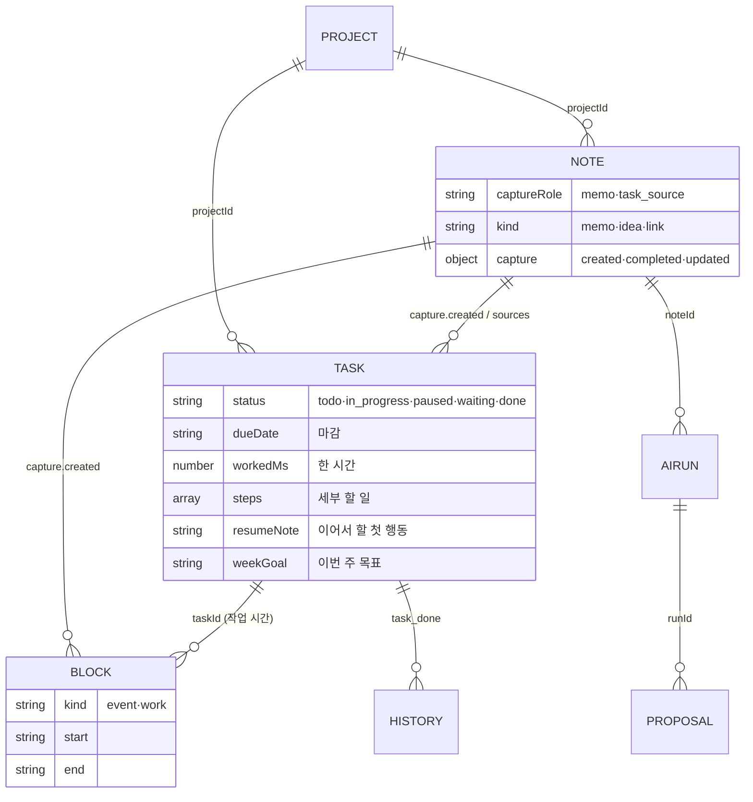

# Daynote 코드 구조

> 던진 글을 AI가 할 일·일정·메모로 나누고, 채팅을 **할 일 작업 공간**으로 쓰는 Windows 데스크톱 앱.
> Electron 32 · 빌드 단계 없는 순수 JS · 핵심 규칙은 Node 테스트로 검증 (`npm test`, 149개).

## 1. 한눈에 보기



- **API 키는 메인 프로세스 안에만** 있습니다. 켜질 때 환경변수·`.env`의 키를 `services/ai.js` 모듈로 옮기고 `process.env`에서 지워서, 화면 프로세스가 키를 물려받지 않게 합니다.
- **`src/core`는 UMD 모듈**이라 화면(`window.Daynote.*`)과 Node(테스트·메인 프로세스) 양쪽에서 같은 코드를 씁니다. 그래서 AI 프롬프트·검증·업무 규칙을 Node 테스트로 확인할 수 있습니다.

## 2. 폴더

```
daynote/
├─ main.js               메인 프로세스: 창, 트레이, 빠른 메모 창, 전역 단축키, 단일 실행, 저장(원자적 쓰기 + .bak), IPC
├─ preload.js            화면에 여는 API (저장·내보내기·AI·빠른 메모 수신)
├─ quick-preload.js      빠른 메모 창 전용 API
├─ services/
│  ├─ ai.js              AI 호출 — 분류는 gemini-3.5-flash-lite, 나머지는 gemini-3.8-flash, 서로 대체 / 키 가림
│  └─ keystore.js        .env 읽기, 설정에서 넣은 키를 Windows DPAPI 로 암호화 보관
├─ src/core/             순수 규칙 (DOM 없음, 테스트 대상)
│  ├─ dates.js           날짜·시각, 남은 시간("3시간 남음"), 월간 달력 칸
│  ├─ model.js           상태 모양(SCHEMA v3), 할 일·메모·블록 CRUD, 시작/일시 정지/완료, 한 시간 기록
│  ├─ recommend.js       "지금 할 일" 추천 규칙
│  ├─ suggest.js         메모·메일에서 할 일 후보 (규칙)
│  ├─ weekly.js          주간 정리·보고서 초안
│  ├─ split.js           홈 세 칸 비율, 좌우 비율, 단계 시간 눈금
│  ├─ habits.js          연구 기반 도움 (계획 오류 보정, 50분 휴식, 하루 마무리, 새 주 목표 …)
│  └─ ai/
│     ├─ organizeNote.js 메모 정리 프롬프트·스키마 (기준)
│     ├─ capture.js      던진 글 분류 프롬프트·스키마 (capture.v7)
│     ├─ validate.js     AI 결과 검증 — 근거 인용, 날짜·시각 재계산("30분 후"), 중복
│     ├─ proposals.js    검증 결과 반영 — 할 일·일정 만들기, 완료 보고, 날짜 바꾸기, 묶음 바꾸기, 종류 바꾸기·되돌리기
│     ├─ commands.js     채팅 명령 — 바로 알아듣기(matchLocal), AI 명령 검증(resolve)
│     ├─ assist.js       작게 나누기·자세히 적기 프롬프트, 제안 시점(nudge)
│     └─ fake.js         데모 AI (규칙 기반 — 브라우저 미리보기·스크린샷·smoke)
├─ renderer/
│  ├─ index.html         스크립트 로드 순서 = 의존 순서 (core → 공통 → 흐름 → 뷰)
│  ├─ store.js           상태 저장소: mutate/undo, 디바운스 저장, 저장 실패 시 localStorage
│  ├─ ui.js              h() DOM 도우미, 아이콘, 칩(마감·상태), 메뉴·팝오버, 세부 할 일 펼치기
│  ├─ app.js             앱 셸: 사이드바, 화면 전환, 단축키, 할 일 동작(시작·멈춤·완료·미루기)
│  ├─ aiflow.js          메모 화면 'AI 정리' 흐름
│  ├─ capture.js         던진 글 → 저장 → AI 분류 → 반영
│  ├─ assistant.js       채팅 조수: 명령 실행, 작업 카드, 작게 나누기, 추천, 휴식, 하루 마무리, 제안 시점
│  ├─ palette.js         Ctrl+K 검색·명령
│  ├─ editor.js · rules.js  마크다운 편집기 (CodeMirror 5, MD_Reflo 에서 가져옴)
│  ├─ quick.html · quick.js 빠른 메모 창
│  └─ views/             화면 하나당 파일 하나
│     ├─ today.js        홈: 채팅 | 오늘(할 일·메모·일정), 칸 비율·끌어 놓기
│     ├─ chat.js         채팅(작업 공간) 목록·입력·카드들
│     ├─ calendar.js     월간(기본)·주간·일간, 끌어 놓으면 24시간 시간표
│     ├─ tasks.js · notes.js · archive.js · projects.js · weekly.js · inbox.js · review.js
│     ├─ detail.js       할 일 자세히 편집 (오른쪽 클릭 → 자세히 편집)
│     ├─ schedule.js     일정·작업 시간 배치 대화상자, 빈 시간 찾기
│     └─ settings.js     AI 키, 화면(테마·트레이), 데이터, 단축키
├─ test/                 node:test — core 와 services 를 Node 에서 직접 검증 (16개 파일)
└─ scripts/              serve(브라우저 미리보기), shots(스크린샷), make-icons, fix-electron
```

## 3. 렌더러 모듈 층

`index.html`이 아래 순서로 불러옵니다. 위층은 아래층만 씁니다.



## 4. 던진 글이 처리되는 길



**AI는 해석만, 확정은 앱이.** AI가 준 날짜·시각은 앱이 다시 계산하고, 대상 할 일은 앱이 실제 목록에서 찾고, 근거 문장이 원문에 없으면 버립니다.

## 5. 상태 (daynote-data.json)



그 밖에 `chat`(채팅·카드 기록), `prefs`(테마·칸 비율·트레이), `meta`(마지막 제안 시각 등), `suggestions`·`emails`·`reports`가 있습니다.

## 6. 확인하는 방법

| 명령 | 하는 일 |
|---|---|
| `npm.cmd test` | core·services 테스트 (Node, 창 없음) |
| `npm.cmd run smoke` | 숨긴 창으로 모든 화면을 그려 보고 콘솔 오류 확인 (데모 AI) |
| `npm.cmd run shots` | 숨긴 창으로 화면별 스크린샷 → `screenshots/` |
| `npm.cmd run serve` | 브라우저 미리보기 `http://localhost:5178/renderer/index.html?fakeai` (데모 AI) |
| `npm.cmd start` | 실제 앱 (Gemini) |
